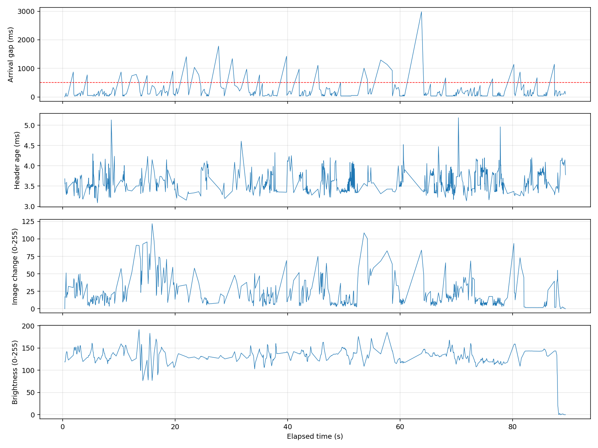

# カメラを動かした際のフリーズ測定（2026年11月6日）

既存のUSBカメラ・旧版v4l2_camera 0.6.2・rqtを動かしたまま、`/image_raw` を追加購読して約90秒測定した。配信・露出・解像度の設定変更は行っていない。画像は保存せず、縮小した画素サンプルから変化量と明るさを計算した。

## 結果

| 指標 | 結果 |
| --- | --- |
| 受信画像 | 799枚 |
| 受信レート | 約8.96 fps |
| 受信間隔の中央値 | 36.2 ms |
| 受信間隔の95パーセンタイル | 400.9 ms |
| 最長受信間隔 | 2983.4 ms |
| 0.5秒超の空白 | 31回 |
| 1秒超の空白 | 12回 |
| メッセージ時刻から受信までの差の中央値／最大 | 3.55／5.18 ms |
| カメラCPU（20秒サンプル、1コア=100%） | 平均12.6%、最大16.0% |
| rqt CPU（同上） | 平均3.5%、最大7.0% |
| 測定付近のUSB切断・UVCエラー | カーネルログに該当記録なし |

## 動きとの関係

画像変化量は隣接する受信画像の縮小グレースケールの平均絶対差。物理的なカメラの移動量そのものではなく、照明変化や物体の動きも含む。各フレームの変化量と「その次の受信までの間隔」を比較した。

| グループ | サンプル数 | 次の受信までの平均 | 次の受信が0.5秒超になる割合 |
| --- | --- | --- | --- |
| 変化量の小さい下位25% | 200 | 70.2 ms | 1.5% |
| 変化量の大きい上位25% | 200 | 194.7 ms | 9.5% |

順位相関は約0.28で、変化の大きいフレームの後に受信が遅れる傾向がある。ただし、受信が飛ぶと画像差も大きくなりやすく、連続する停止や撮影内容の違いも影響するため、因果関係の証明ではない。後半に静止を依頼したが画像の変化が残っているため、厳密な静止・移動の比較試験とは扱っていない。

## 分かったこと・まだ分からないこと

- rqtの表示だけでなく、追加購読でも画像が来ない時間を確認した。
- 測定中はUSB切断ログや対象プロセスのCPU飽和は確認できない。ただしUSB転送の一時停止やシステム全体のスケジューリング問題は否定できない。
- 非圧縮RGB・640×480で1枚921600バイト。今回JPEG変換は使用していないため、映像内容によるJPEG圧縮負荷ではない。
- 旧版ドライバはカメラのバッファを取得した後に `now()` でヘッダー時刻を付ける。数msという時刻差は、実際の撮影から表示までの遅延を表さない。
- 受信に成功した画像の時刻差は小さいが、「撮影／USB取得が止まる」「ドライバが配信で待つ」「DDSで画像が失われる」は、今回の受信側測定だけでは区別できない。
- 露出パラメータの読み取り値は `auto_exposure=3`, `exposure_time_absolute=313`, `gain=32`。固定露出との比較は行っていないため、自動露出が原因とは断定していない。

次の切り分けは、ドライバ内でV4L2取得の前後とpublish前後の時間・バッファsequenceを記録し、撮影側の停止か配信側の停止かを特定すること。画像処理や中継を増やす必要はない。必要ならその後、同じ明るさで静止／移動、固定露出／自動露出を比較する。

生データ（Git管理外）：`log/camera_analysis/motion_frames.csv`、`summary.json`、`process_samples.json`。
